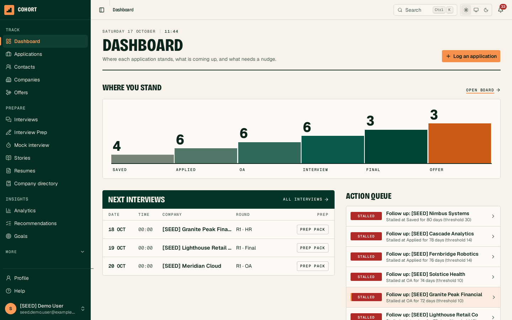
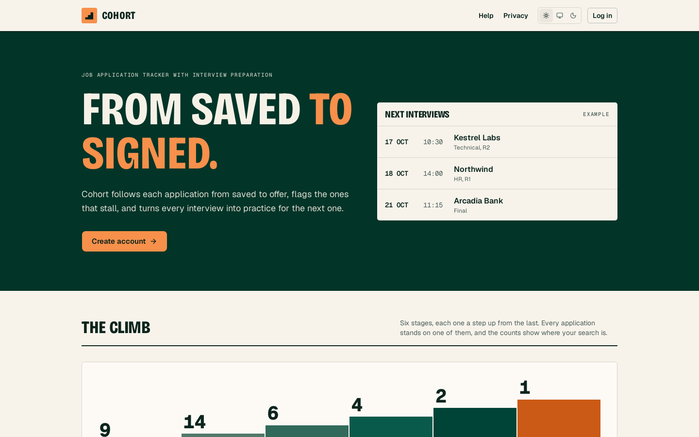
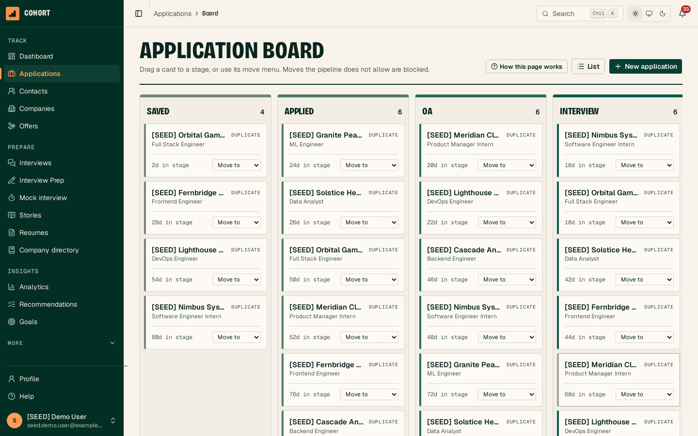
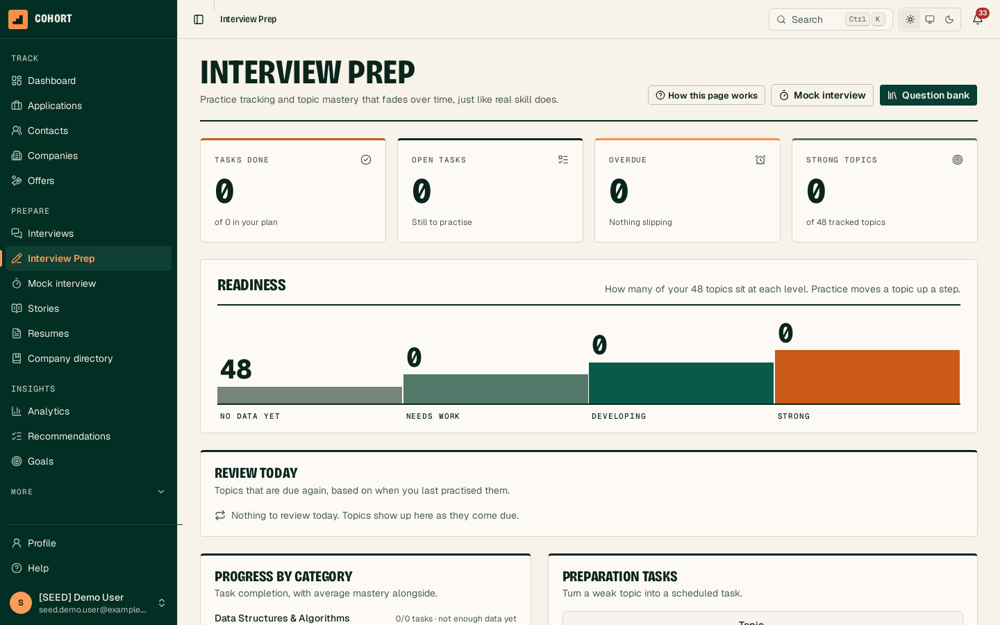
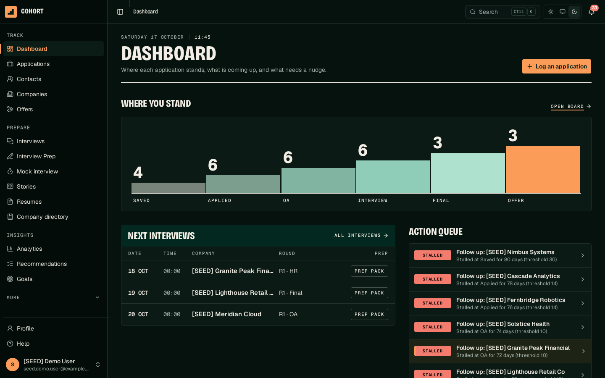

# Cohort

[](https://github.com/AadityaKaushik/Cohort-Project_Commit/actions/workflows/ci.yml)

Cohort is a job application tracker with interview preparation. It follows every application from saved to offer, flags the ones that stall, captures what was asked in each interview, and turns that into targeted practice. A federated learning service learns from many users' preparation patterns without collecting their data, and a Privacy Ledger shows each user exactly what was shared.

IT314 Software Engineering project.



## Features

**Track**
- Applications as a list or a board, with a stage machine that refuses illegal moves and explains why
- Stall detection against the user's own usual wait for each stage
- CSV import (including LinkedIn's export) and a "Save to Cohort" bookmarklet for job pages
- Contacts and referrals, company pages, a company interview directory, offer comparison, weekly goals with a heatmap
- Resume versions with a section editor, cloning and PDF export
- Global search from the command palette (`Ctrl K`)

**Prepare**
- Interview rounds with a guided debrief that takes under 3 minutes
- A question bank of 288 original questions across 48 topics; any question asked in an interview can be saved to it
- Topic mastery that fades without practice, prerequisite-aware recommendations and a daily review queue
- A timed, self-graded mock interview from the weakest topics, and a STAR story bank
- Job readiness per application, interview prep packs, resume and job description matching

**Insights**
- Funnel, conversion, rejection and time-in-stage analytics, each showing its sample size
- Explainable recommendations with four evidence tiers and a build-time check against causal wording
- In-app notifications, PDF and CSV reports
- Opt-in federated learning with clipping, noise, a minimum cohort and a per-user Privacy Ledger

**Account**
- Email and password (Argon2id), or Google, GitHub or LinkedIn sign-in
- Password reset, email verification, data export and account deletion
- Light and dark themes, responsive down to phone width, onboarding, sample data and a guided tour

| | |
|---|---|
|  |  |
|  |  |

## Stack

| Layer | Technology |
|---|---|
| Frontend | React 19, TypeScript, Vite, Tailwind CSS, shadcn/ui, TanStack Query, Recharts |
| Backend | Java 21, Spring Boot 3, Spring Security (JWT, Argon2id, OAuth2) |
| Database | PostgreSQL 16, Spring Data JPA, Flyway |
| Federated learning | Python, Flower, scikit-learn, FastAPI (`fl-service/`) |
| AI | Ollama on a local model by default, Google Gemini optional |
| Resilience | Resilience4j circuit breaker between the API and the FL service |
| Testing | JUnit 5, MockMvc, Testcontainers, pytest, Vitest, React Testing Library |
| DevOps | Docker Compose, GitHub Actions |

## Getting started

You need Docker (or Podman) with Compose.

```
cp .env.example .env
docker compose up --build
```

- Frontend: http://localhost:5173
- API: http://localhost:8080
- Postgres: host port 5433

The `dev` profile loads demo data. Sign in with `seed.demo.user@example.com` / `SeedDemo123!`.

With the federated learning service as well:

```
docker compose -f docker-compose.yml -f docker-compose.fl.yml up --build
```

Social sign-in buttons appear for each provider whose client ID and secret are set in `.env` (`GOOGLE_CLIENT_ID`, `GITHUB_CLIENT_ID`, `LINKEDIN_CLIENT_ID` and the matching `_SECRET`). The redirect URL to register with each provider is `http://localhost:8080/login/oauth2/code/<provider>`.

Without containers for the app itself, start Postgres, then:

```
cd api && mvn spring-boot:run -Dspring-boot.run.profiles=dev
cd frontend && npm install && npm run dev
```

## Tests

```
cd api && mvn test            # needs a container runtime for Testcontainers
cd frontend && npm test
cd fl-service && pytest
```

CI runs all three suites, a 70% backend coverage gate, a secret scan and a check for string-built SQL on every pull request. See [`docs/testing.md`](docs/testing.md).

## Repository layout

```
api/          Spring Boot application
frontend/     React application
fl-service/   Flower client and server, scikit-learn model, FastAPI control API
docs/         Project documentation
scripts/      CI helper scripts
```

## Documentation

| Document | Contents |
|---|---|
| [`docs/overview.md`](docs/overview.md) | What Cohort is and how it works, in plain language |
| [`docs/requirements.md`](docs/requirements.md) | Stakeholders, functional and non-functional requirements, user stories, backlog |
| [`docs/architecture.md`](docs/architecture.md) | System design, data model, design patterns, security, deployment |
| [`docs/recommendations-and-fl.md`](docs/recommendations-and-fl.md) | Recommendation engine and federated learning |
| [`docs/sprints.md`](docs/sprints.md) | Team, nine sprints and 104 phases |
| [`docs/testing.md`](docs/testing.md) | Test strategy and the test behind each check |
| [`docs/design.md`](docs/design.md) | Interface design system |
| [`docs/data-quality-rules.md`](docs/data-quality-rules.md) | Input checks for user-entered text |
| [`docs/company-directory.md`](docs/company-directory.md) | Company directory data and sourcing rules |
| [`docs/poster.html`](docs/poster.html) | Project poster |

## Sprints

| Sprint | Goal | Phases |
|---|---|---|
| 1 | Foundation | P01-P15 |
| 2 | Resumes and interview capture | P16-P26 |
| 3 | Preparation and analytics | P27-P38 |
| 4 | Recommendations and federated learning | P39-P59 |
| 5 | Notifications, reports and account | P60-P69 |
| 6 | Experience and core gaps | P70-P82 |
| 7 | Job-search workflow | P83-P89 |
| 8 | AI and interview preparation | P90-P98 |
| 9 | Hardening and delivery | P99-P104 |

## Team

| Department | Members |
|---|---|
| Backend | Anuj Madhani, Harshit Goyal, Achintya Chandwani, Dev Bhavsar |
| Frontend | Anshul Rai, Chinmay Dak |
| AI/ML | Aaditya Kaushik, Nirmal Nakum, Ved Dhanani, Abhishek Singh |

## Contributing

See [`CONTRIBUTING.md`](CONTRIBUTING.md).

## License

See [`LICENSE`](LICENSE).
